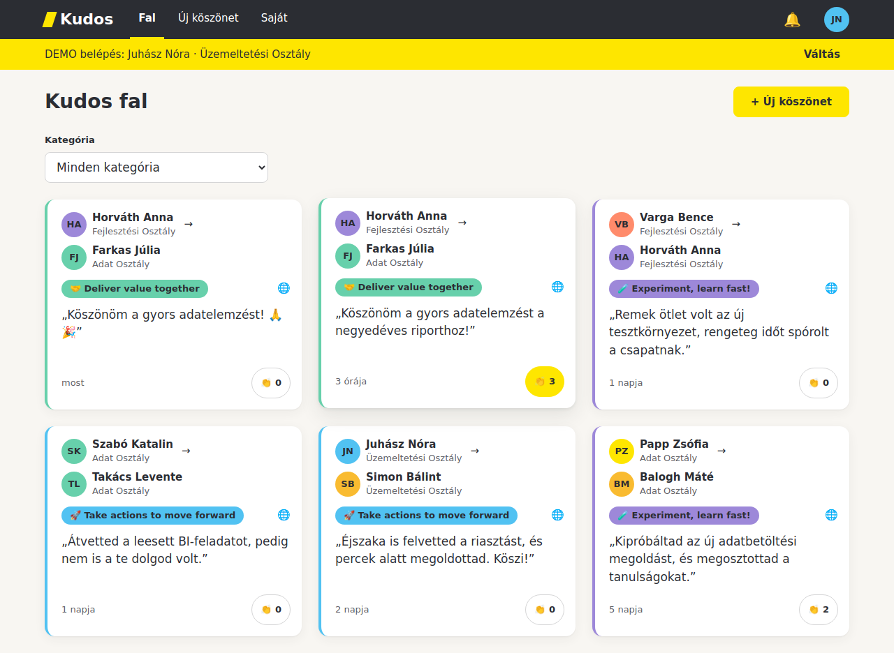

# Kudos – kész mintamegoldás

Ez a [B-1 vezetői AI-workshop](https://wydrian1.github.io/b1training/) délutáni gyakorlatának **végigvitt, elfogadott megoldása**.
A kiinduló repóból ([wydrian1/b1-demo-kudos](https://github.com/wydrian1/b1-demo-kudos)) Claude Code-dal, **spec-driven** módon készült, a [lab guide](https://wydrian1.github.io/b1training/lab/) lépéseit követve: specifikáció → 1. kapu → storyk → bizonyíték → 2. kapu → dokumentáció.

> A gyakorlathoz ne ezt a repót használd, hanem a kiinduló repót. Ez a megoldás arra való, hogy összevesd vele a saját eredményedet, vagy megmutasd, hova lehet eljutni.



## Számokban

| | |
|---|---|
| Specifikáció | `SPEC.md` 1.1-es verzió: 16 üzleti szabály (SZ), 47 elfogadási kritérium (EK), 7 story |
| Tesztek | **117 unit** és **45 böngészős (E2E)** teszt, mind zöld |
| 1. kapu | `SPEC.md`: `Státusz: JÓVÁHAGYVA` |
| 2. kapu | `BIZONYITEK.md`: `Elfogadás: ELFOGADVA` |
| Dokumentáció | felhasználói útmutató 11 képernyőképpel, technikai leírás, nyomonkövethetőségi mátrix |

## A storyk

| Story | Miről szól | EK-k | MVP |
|---|---|---|---|
| S1 | Belépés és köszönet küldése a 3 lépéses varázslóval | EK-01…EK-07 | ✅ |
| S2 | Küldési szabályok, érthető hibaüzenetek | EK-08…EK-13, EK-47 | ✅ |
| S3 | Saját kapott és küldött köszönetek, keresés, szűrés | EK-14…EK-21 | ✅ |
| S4 | Közös fal és 👏 taps | EK-22…EK-28 | ✅ |
| S5 | Értesítések (címzett, közvetlen vezető, B-1) | EK-29…EK-35 | |
| S6 | Vezetői nézet a szervezeti körre | EK-36…EK-41 | |
| S7 | Vezetői statisztika | EK-42…EK-46 | |

A részletek a [`SPEC.md`](SPEC.md) 8. szakaszában, a haladás a [`HALADAS.md`](HALADAS.md)-ben van.

## Mit érdemes megnézni?

| Fájl | Miért érdekes |
|---|---|
| [`SPEC.md`](SPEC.md) | Hogyan lesz az üzleti leírásból ellenőrizhető specifikáció: szabályok, Adott / Amikor / Akkor kritériumok konkrét nevekkel, storyk |
| [`BIZONYITEK.md`](BIZONYITEK.md) | A 2. kapu alapja: melyik kritériumot melyik teszt igazolja, böngészős tesztek storynként, kézi ellenőrző forgatókönyv |
| [`dokumentacio/`](dokumentacio/) | Az elfogadott változat dokumentációja, a tényleges kódból: [felhasználói útmutató](dokumentacio/felhasznaloi-utmutato.md), [technikai leírás](dokumentacio/technikai-leiras.md), [nyomonkövethetőség](dokumentacio/nyomonkovethetoseg.md) |
| [`tests/`](tests/), [`tests/e2e/`](tests/e2e/) | Unit és böngészős (Playwright) tesztek storynként, EK-hivatkozással a nevükben |
| [`kudos/`](kudos/), [`static/`](static/), [`app.py`](app.py) | A megvalósítás: Python standard library, SQLite, vanilla HTML/CSS/JS, külső csomag nélkül |
| [`CLAUDE.md`](CLAUDE.md), [`.claude/skills/`](.claude/skills/) | A szabályok és a skillek (`/spec`, `/build`, `/verify`, `/docs`), amelyekkel a megoldás készült |

## Futtatás

WSL-ben (Ubuntu), Python 3.10 vagy újabb:

```bash
git clone https://github.com/wydrian1/b1-demo-kudos-solution.git kudos-megoldas
cd kudos-megoldas
python3 app.py
```

Majd a böngészőben: http://localhost:8000. A belépés DEMO: a listából választod ki, kinek a nevében lépsz be.

## Tesztek

```bash
python3 -m unittest discover -s tests -v
```

A böngészős tesztekhez egyszer telepíteni kell a Playwrightot és a Chromiumot (internet és `sudo` kell hozzá):

```bash
bash scripts/setup-e2e.sh
.venv/bin/python -m unittest discover -s tests/e2e -v
```

Látható böngészőablakban (Windows 11-en a WSLg külön ablakot nyit):

```bash
HEADED=1 .venv/bin/python -m unittest discover -s tests/e2e -v
```

## Tudnivalók

- **Minden adat kitalált.** A munkatársak a `data/munkatarsak.json`-ban vannak (`@pelda.local` címekkel), ez helyettesíti az AD-t. Valós személyekhez nincs közük.
- **Csak helyben fut**, demó célra: nincs valódi bejelentkezés, e-mail- vagy Teams-értesítés, és nincs szerveres üzemeltetés. A szándékosan kihagyott részek a `SPEC.md` „Kimarad” szakaszában vannak.
- A hivatalos Raiffeisen-logót a felület nem használja, csak a színeket (`docs/arculat-ui.md`).
