# Kudos – felhasználói útmutató

Ez az útmutató a Kudos demóalkalmazás **1.1-es, elfogadott változatáról** szól. A képeken kitalált
munkatársak és minta-köszönetek látszanak.

## 1. Mire való a Kudos?

A Kudos egy belső „köszönő” felület. Ha egy kollégád segített, vagy jól dolgozott, **köszönetet küldhetsz
neki** néhány kattintással. A köszönetet az érintettek és a vezetőik látják. Ha te teszed nyilvánossá, az egész
cég látja a közös falon, és tapsolhat rá.

- **Munkatársként** köszönetet küldesz, látod a kapott és küldött köszönetidet, böngészed a közös falat, és tapsolsz.
- **Vezetőként** ezen felül látod a saját szervezeti köröd köszöneteit és azok statisztikáját.

> **DEMO:** a belépés szimulált. Nincs jelszó, a listából kiválasztod, ki vagy. A sárga sáv minden oldalon
> jelzi ezt. Valódi céges beléptetés, e-mail vagy Teams értesítés nincs.

## 2. Belépés

1. Nyisd meg a http://localhost:8000 címet.
2. A listában kattints a saját nevedre (például **Horváth Anna**).

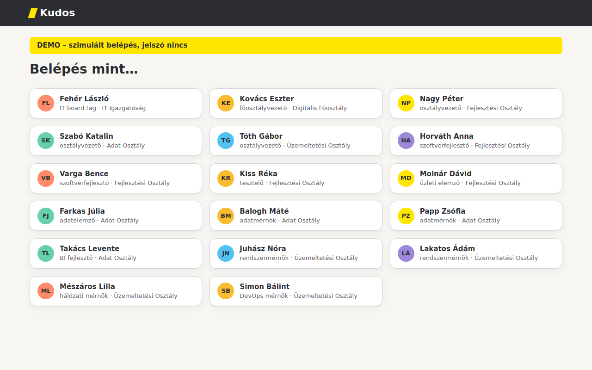

Belépés után minden oldal tetején látszik a neved és az egységed. Ha másik munkatársként akarsz belépni,
kattints a sárga sávban a **Váltás** gombra.

Belépés nélkül nem érsz el semmit: a rendszer a belépési oldalra irányít.

## 3. Köszönet küldése (3 lépésben)

Kattints az **Új köszönet** menüpontra (vagy a **+ Új köszönet** gombra).

### 1. lépés – Kinek?

Kezdj el gépelni a keresőbe: név, egység vagy e-mail-cím részlete is jó (például `adat` vagy `julia.f`).
A találatok között a ↑ ↓ billentyűvel is választhatsz, Enterrel kiválasztod, Esc-kel bezárod a listát.
Magadat nem találod meg a listában, mert magadnak nem küldhetsz köszönetet.

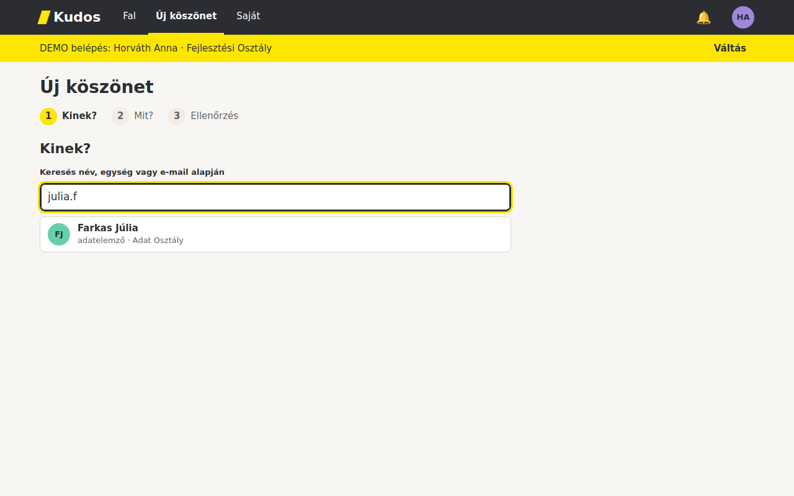

### 2. lépés – Mit?

Itt három dolgot adsz meg:

- **Kategória** – pontosan egyet kell választanod a négy közül:
  - 💛 **Earn customer loyalty** – az ügyfélért tett erőfeszítés
  - 🚀 **Take actions to move forward** – nem várt, cselekedett, feloldott egy elakadást
  - 🤝 **Deliver value together** – közös munka, együtt teremtett érték
  - 🧪 **Experiment, learn fast!** – kipróbált valami újat, tanult belőle
- **Üzenet** – legfeljebb 500 karakter, emoji is jó. Írás közben látod a számlálót (például `34 / 500`).
- **Láthatóság** – **🔒 Privát** (alapértelmezés) vagy **🌐 Nyilvános**.

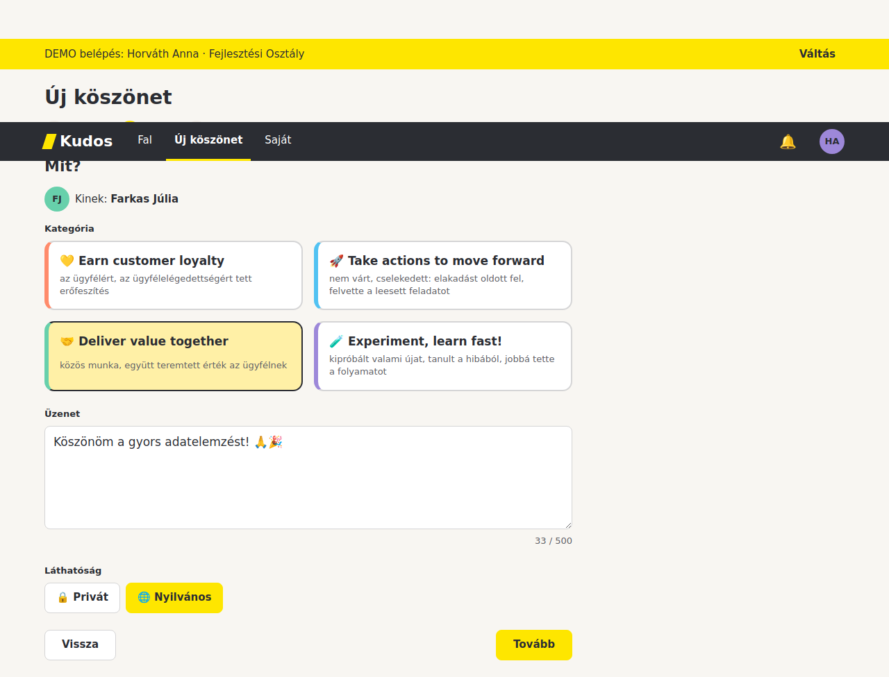

Ha valamit kihagysz, a **Tovább** gomb után a hiba a mező alatt jelenik meg, és megmondja, mit javíts:

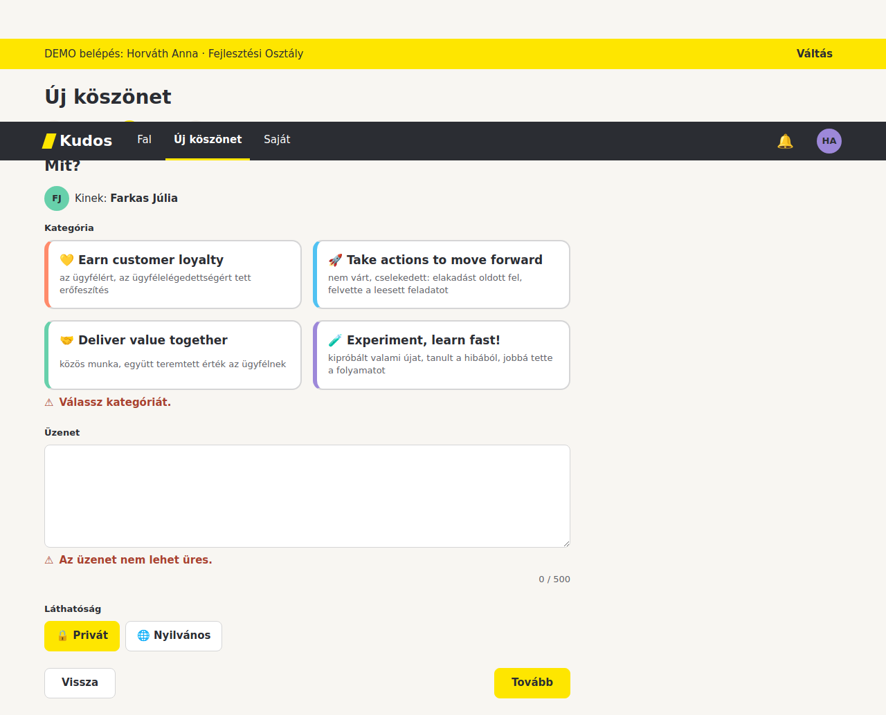

### 3. lépés – Ellenőrzés

Itt a kész kártyát látod úgy, ahogy a címzett is látni fogja. Ha minden jó, kattints a **Küldés** gombra.
A **Vissza** gombbal javíthatsz.

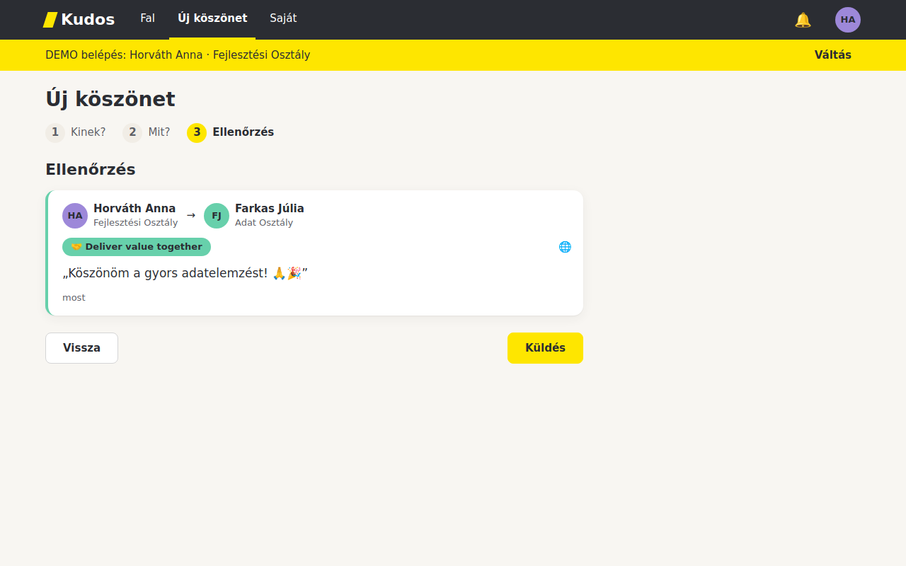

Küldés után a **Saját köszönetek → Küldött** lista nyílik meg, és egy rövid visszaigazolás („Köszönetedet
elküldtük …!”) jelenik meg.

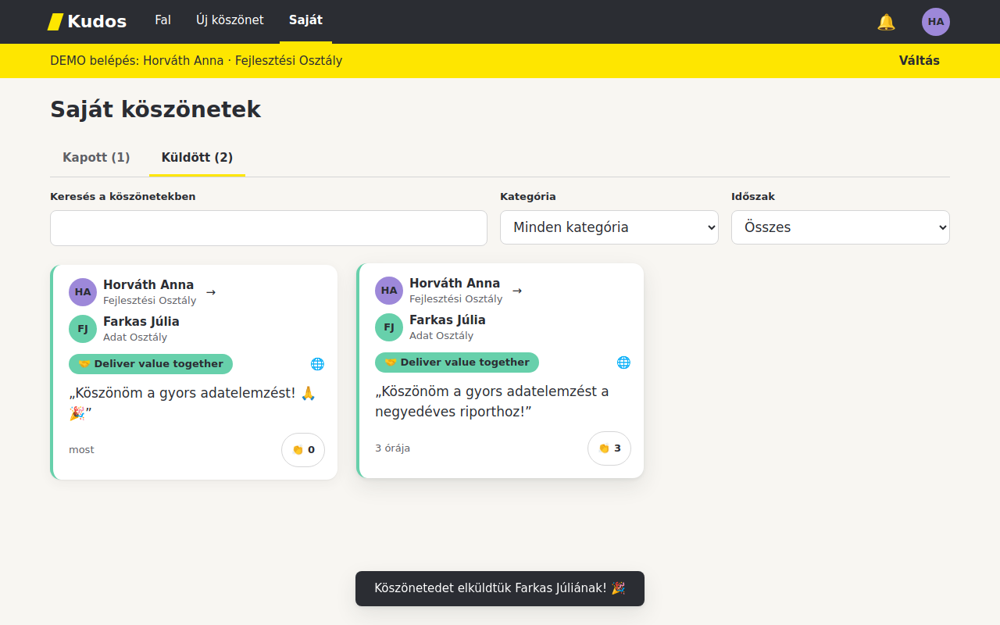

## 4. Saját köszöneteim

A **Saját** menüpont két fület mutat: **Kapott (n)** és **Küldött (n)**. A legújabb köszönet van elöl.

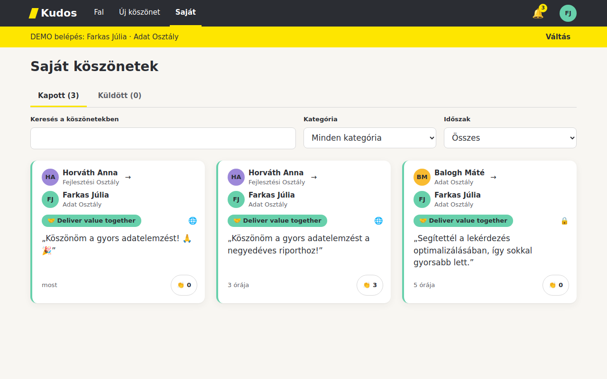

Szűrhetsz és kereshetsz:

- **Keresés:** az üzenet szövegében, a küldő és a címzett nevében (kis- és nagybetűre nem érzékeny, de az ékezetre igen: „julia” nem találja a „Júlia” nevet).
- **Kategória:** egy kategóriára szűkít.
- **Időszak:** elmúlt 7 nap, elmúlt 30 nap, vagy összes.

Ha semmi nem felel meg, a **Szűrők törlése** gombbal visszaállíthatod a nézetet. Ha még nincs köszönetted,
a lista egy barátságos üzenetet és egy **+ Új köszönet** gombot mutat.

## 5. Közös fal és taps

A **Fal** menüpont a kezdőoldal. Itt **csak a nyilvános köszönetek** jelennek meg, mindenkinek ugyanazok, a
legújabbal kezdve. Kategória szerint szűrhetsz.

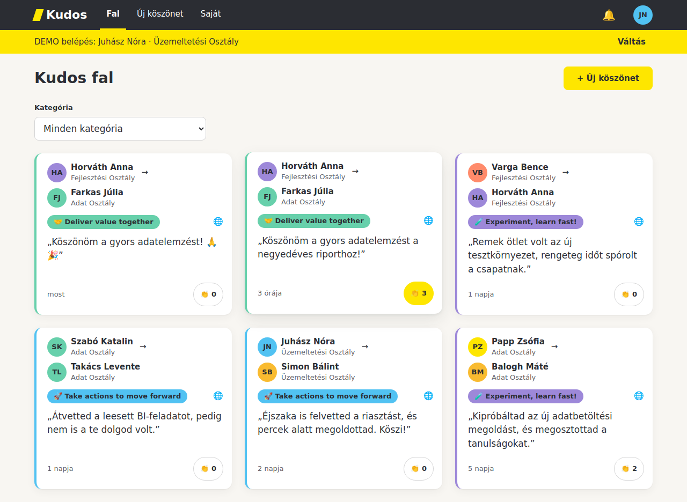

A kártya jobb alsó sarkában lévő **👏** gombbal tapsolhatsz. Egy köszönetre egyszer tapsolhatsz, még egy
kattintás visszavonja. A küldő és a címzett is tapsolhat a saját köszönetére. Privát köszönetre csak az
tapsolhat, aki látja is.

## 6. Értesítések

A fejlécben lévő **🔔** csengő mutatja az olvasatlan értesítések számát. Kattints rá, és megnyílik a lista.

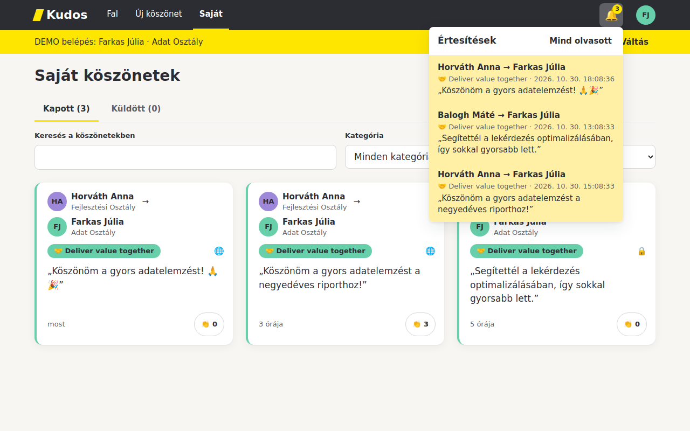

- Egy értesítésre kattintva olvasottnak jelölöd.
- A **Mind olvasott** gomb az összeset olvasottnak jelöli.
- A lista az oldal betöltésekor és a csengő megnyitásakor frissül, magától nem.

**Ki kap értesítést, ha valaki köszönetet küld?** A címzett, a címzett közvetlen vezetője és a címzett B-1 szintű
(főosztályvezető) vezetője. Más nem. A küldő a saját köszönetéről soha nem kap értesítést, még akkor sem,
ha egyébként vezetője a címzettnek.

## 7. Vezetőknek: Csapatköszönetek és statisztika

Ha vezető vagy (van legalább egy beosztottad), megjelenik a **Csapat** menüpont. Itt látod minden olyan
köszönetet – **privátot is** –, amelynek a küldője vagy a címzettje a **te szervezeti köredbe** tartozik.
A köröd te magad, és mindenki, aki alattad van, bármilyen mélységben.

A lap tetején a statisztika is megjelenik a kiválasztott időszakra (alapértelmezés: elmúlt 30 nap):

- **kapott köszönet** és **küldött köszönet** a körödben,
- **aktív küldő:** hányan küldtek legalább egyet a körödből,
- **összes köszönet:** a nézetben szereplők száma,
- kategóriánkénti sávdiagram,
- **Legtöbb köszönetet kapott:** legfeljebb 3 fő (azonos darabszámnál ábécérendben).

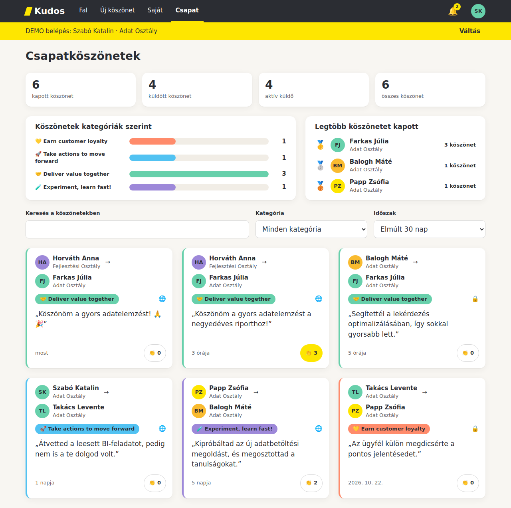

Az időszak átváltása a számokat és a listát is megváltoztatja. A keresés és a kategóriaszűrő csak a listára hat,
a statisztikára nem.

### Ki mit lát?

| | Munkatárs | B-2 (osztályvezető) | B-1 (főosztályvezető) | B (board tag) |
|---|---|---|---|---|
| Közös fal (nyilvános köszönetek) | igen | igen | igen | igen |
| Saját kapott és küldött köszönetek | igen | igen | igen | igen |
| Csapat menüpont és statisztika | nem | igen, a saját osztálya | igen, a főosztálya | igen, az egész IT Igazgatóság |
| Mások privát köszönete | nem | a körébe tartozóké | a körébe tartozóké | a körébe tartozóké |
| Értesítés | ha címzett | ha címzett, vagy a címzett közvetlen vezetője | ha címzett, a címzett közvetlen vezetője, vagy a címzett B-1 vezetője | ha címzett, vagy a címzett közvetlen vezetője |

Példa: Szabó Katalin (Adat Osztály) a Horváth Anna (Fejlesztési Osztály) → Varga Bence köszönetet nem látja, mert
egyik szereplő sem tartozik az ő körébe. Nagy Péter (a Fejlesztési Osztály vezetője) viszont igen.

## 8. Mobilon

Keskeny képernyőn (640 px alatt) a menü alulra kerül, mint tab-sáv, és a kártyák egy oszlopban követik egymást.

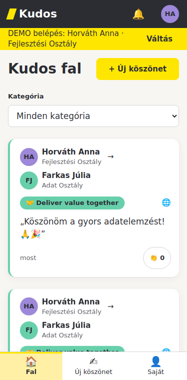

## 9. Szabályok röviden

- Egy köszönetnek **pontosan egy címzettje** van, magadnak nem küldhetsz.
- Az üzenet nem lehet üres, és legfeljebb **500 karakter**.
- **Kategória választása kötelező.**
- Ugyanannak a kollégának egy napon (éjféltől éjfélig) **legfeljebb 3 köszönetet** küldhetsz. A 4. próbálkozásra ezt kapod: „Ugyanannak a munkatársnak ma már 3 köszönetet küldtél.” Másnak ugyanaznap küldhetsz.
- A láthatóság alapértelmezése **privát**. Privátot a küldő, a címzett és a körükhöz tartozó vezetők látnak. Nyilvánosat mindenki.
- A küldött köszönet **nem szerkeszthető és nem törölhető**.
- A küldés idejét a rendszer rögzíti, nem te adod meg.

## 10. Gyakori kérdések

**Miért nem találom magamat a címzettkeresőben?**
Mert magadnak nem küldhetsz köszönetet.

**Elküldtem egy köszönetet, de a falon nem látom. Miért?**
Valószínűleg privát. A falon csak a nyilvános köszönetek jelennek meg. A saját Küldött listádon ott van.

**Elírtam az üzenetet. Javíthatom?**
Nem, a köszönet küldés után nem szerkeszthető és nem törölhető. Küldés előtt, az Ellenőrzés lépésen még
visszaléphetsz.

**Nem látom a Csapat menüpontot.**
Csak vezetőknek jelenik meg. Ha nincs beosztottad, nincs ilyen menüpontod. A címét közvetlenül megnyitva sem látsz
adatot, a rendszer jelzi, hogy vezetői jogosultság kell.

**A csengő nem frissült, pedig új köszönetet kaptam.**
Az értesítések az oldal betöltésekor és a csengőre kattintáskor frissülnek. Töltsd újra az oldalt, vagy nyisd meg a csengőt.

**Mit jelent a sárga DEMO sáv?**
Azt, hogy ez egy bemutató változat: a belépés szimulált, az adatok csak a te gépeden vannak.
