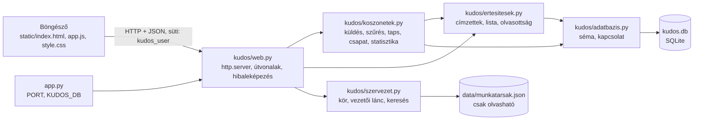

# Kudos – technikai leírás

Fejlesztőknek és üzemeltetőknek, a **SPEC 1.1** szerint elfogadott változatról. Minden állítás a kódból és
a `SPEC.md`-ből származik.

## 1. Áttekintés

- Nyelv és könyvtárak: Python 3.10+ **csak standard library** (`http.server`, `sqlite3`, `json`, `unittest`), külső csomag, hálózati hívás és CDN nincs.
- Felület: sima HTML, CSS és vanilla JavaScript a `static/` mappában, egyoldalas alkalmazás hash-útvonalakkal (`#/fal`, `#/uj`, `#/sajat/kapott`, `#/csapat`, `#/belepes`).
- Adattárolás: SQLite fájl (`kudos.db`, nem kerül a gitbe).
- A belépés **szimulált** (DEMO), valódi AD/SSO, e-mail vagy Teams integráció nincs.

## 2. Architektúra



| Fájl | Felelősség |
|---|---|
| `app.py` | Belépési pont: a `PORT` és `KUDOS_DB` környezeti változó beolvasása, szerver indítása a `127.0.0.1` címen. |
| `kudos/web.py` | `ThreadingHTTPServer`, útvonalválasztás, süti-azonosítás, JSON-válaszok, statikus fájlok. Üzleti szabályt nem tartalmaz. |
| `kudos/szervezet.py` | `Szervezet` osztály: munkatársak betöltése, `vezeto_e`, `kor`, `felettesek`, `kereses`. |
| `kudos/koszonetek.py` | Validáció, küldés, napi limit, láthatóság, fal, saját listák, vezetői lista, taps, statisztika. |
| `kudos/ertesitesek.py` | Az értesítendők köre, értesítések létrehozása, listázása, olvasottnak jelölése. |
| `kudos/adatbazis.py` | Séma (`SEMA`), `kapcsolat`, `inicializal`. |
| `static/` | `index.html`, `app.js` (vanilla JS), `style.css` (design tokenekkel kezdődik). |

Az üzleti logika (`kudos/` modulok a `web.py` kivételével) a webes rétegtől független, böngésző és szerver nélkül tesztelhető.

## 3. Adatmodell

A séma az `kudos/adatbazis.py` `SEMA` konstansából, a kapcsolat `PRAGMA foreign_keys = ON` beállítással jön létre.

### `koszonet`
| Mező | Típus | Megjegyzés |
|---|---|---|
| `id` | INTEGER PK AUTOINCREMENT | |
| `kuldo_id` | TEXT NOT NULL | a bejelentkezett felhasználó (a szerver állítja be) |
| `cimzett_id` | TEXT NOT NULL | létező munkatárs, ≠ küldő (alkalmazásszinten ellenőrzött) |
| `kategoria` | TEXT NOT NULL | `loyalty`, `forward`, `together`, `experiment` |
| `uzenet` | TEXT NOT NULL | levágott szóközökkel, 1–500 Unicode-kódpont |
| `lathatosag` | TEXT NOT NULL DEFAULT `'privat'` | `privat` vagy `nyilvanos` |
| `letrehozva` | TEXT NOT NULL | helyi idő, ISO 8601, másodperc pontosság; a szerver rögzíti |

### `taps`
| Mező | Típus | Megjegyzés |
|---|---|---|
| `koszonet_id` | INTEGER NOT NULL, FK → `koszonet(id)` | |
| `munkatars_id` | TEXT NOT NULL | aki tapsolt |
| `letrehozva` | TEXT NOT NULL | |

Elsődleges kulcs: (`koszonet_id`, `munkatars_id`), így egy személy egy köszönetre legfeljebb egy tapsot adhat.

### `ertesites`
| Mező | Típus | Megjegyzés |
|---|---|---|
| `id` | INTEGER PK AUTOINCREMENT | |
| `munkatars_id` | TEXT NOT NULL | akinek szól |
| `koszonet_id` | INTEGER NOT NULL, FK → `koszonet(id)` | |
| `olvasott` | INTEGER NOT NULL DEFAULT 0 | |
| `letrehozva` | TEXT NOT NULL | |

Egyedi: (`munkatars_id`, `koszonet_id`). Az értesítés megjelenített tartalma a köszönetből készül, külön nem tárolt.

### Munkatársak
A `data/munkatarsak.json` (csak olvasható, 17 fő) mezői: `id`, `nev`, `email`, `egyseg`, `beosztas`, `szint` (`B`, `B-1`, `B-2`, `null`), `vezeto_id`. Nem kerül az adatbázisba. A munkamenet egyetlen süti: `kudos_user=<munkatárs id>` (`HttpOnly`, `SameSite=Lax`, `Path=/`).

## 4. HTTP végpontok

Minden válasz JSON (`Content-Type: application/json; charset=utf-8`), a statikus fájlok kivételével. Belépés nélkül csak `GET /api/munkatarsak` és `POST /api/belepes` érhető el, minden más `/api/…` kérés **401**-et ad. Ismeretlen végpont: **404**. Hibás bemenet: **400** `{"hiba": "...", "mezo": "..."}`. A törzs legfeljebb 64 KiB.

| Metódus és útvonal | Ki hívhatja | Mit ad vissza |
|---|---|---|
| `GET /` , `GET /static/<fájl>` | bárki | `index.html`, illetve statikus fájl |
| `GET /api/munkatarsak` | bárki | a 17 munkatárs: `id`, `nev`, `email`, `egyseg`, `beosztas`, `szint` |
| `POST /api/belepes` `{id}` | bárki | `{id}` és `Set-Cookie`; ismeretlen azonosító: 400 |
| `POST /api/kilepes` | bárki | `{}`, a süti törlése |
| `GET /api/en` | belépett | `id`, `nev`, `egyseg`, `beosztas`, `vezeto` (igaz/hamis) |
| `GET /api/munkatarsak/kereses?q=` | belépett | találatok (`id`, `nev`, `beosztas`, `egyseg`), a hívót kivéve; üres `q`: `[]` |
| `POST /api/koszonetek` `{cimzett_id, kategoria, uzenet, lathatosag}` | belépett | **201** és a létrehozott köszönetkártya. Hibák: 400 (validáció, napi limit) |
| `GET /api/koszonetek/kapott`, `…/kuldott` `?q=&kategoria=&idoszak=` | belépett | `{koszonetek: [...], darab: {kapott, kuldott}}`; `idoszak` alapértelmezése `osszes` |
| `GET /api/fal?kategoria=` | belépett | a nyilvános köszönetek kártyái |
| `POST /api/koszonetek/{id}/taps` | belépett, aki látja a köszönetet | `{tapsolt, tapsok}`; nem létező vagy nem látható köszönet: **404** |
| `GET /api/ertesitesek` | belépett | a hívó saját értesítései, a legújabb elöl |
| `POST /api/ertesitesek/{id}/olvasott` | belépett (csak saját) | `{olvasott: true}`; nem a hívóé vagy nem létezik: 404 |
| `POST /api/ertesitesek/olvasott-mind` | belépett | `{olvasott: <módosított darab>}` |
| `GET /api/csapat?q=&kategoria=&idoszak=` | **vezető** | a kör köszönetei; `idoszak` alapértelmezése `30`. Nem vezető: **403** |
| `GET /api/csapat/statisztika?idoszak=` | **vezető** | `kapott`, `kuldott`, `aktiv_kuldok`, `osszes`, `kategoriak[]`, `top3[]`. Nem vezető: **403** |

A köszönetkártya mezői: `id`, `kuldo` és `cimzett` (`id`, `nev`, `egyseg`, `beosztas`), `kategoria`, `uzenet`, `lathatosag`, `letrehozva`, `tapsok`, `tapsolt`.
Az értesítés mezői: `id`, `koszonet_id`, `olvasott`, `kuldo`, `cimzett`, `kategoria`, `elonezet` (legfeljebb 80 karakter, „…”-tal csonkolva), `koszonet_letrehozva`, `letrehozva`.
Más HTTP-módszer a nem-`/api/` útvonalakon: **405**. A válaszok `Cache-Control: no-cache` és `X-Content-Type-Options: nosniff` fejlécet kapnak.

Érvényes szűrőértékek: `kategoria` a négy kód egyike (üres = mind), `idoszak`: `7`, `30`, `osszes`; ismeretlen érték 400.

## 5. Üzleti szabályok a kódban

### Küldés (`koszonetek.kuldes`)
1. Validáció (`_ellenoriz`): létező, a küldőtől eltérő címzett; nem üres, legfeljebb 500 kódpont hosszú üzenet; ismert kategória; ismert láthatóság.
2. `BEGIN IMMEDIATE` tranzakció: megszámolja, hány köszönetet küldött a küldő ugyanannak a címzettnek **ugyanazon a naptári napon** (`substr(letrehozva,1,10)`); ha ≥ 3, `ValidaciosHiba`. Ez a zárolt tranzakció akadályozza meg, hogy párhuzamos kérések átlépjék a határt.
3. A köszönet és az értesítések **egy tranzakcióban** mentődnek, hiba esetén rollback.
4. Az időpontot a szerver adja (`datetime.now()`), a kliens nem.

### Szervezeti kör, vezetői lánc (`szervezet.py`)
- `vezeto_e(id)`: igaz, ha van legalább egy munkatárs, akinek `vezeto_id`-ja ez az azonosító.
- `kor(id)`: a munkatárs és minden beosztottja bármilyen mélységben (szélességi bejárás a `vezeto_id` éleken).
- `felettesek(id)`: a `vezeto_id` láncon felfelé a legközelebbitől (közvetlen vezető, B-1, B); körkörös hivatkozás ellen védett.

### Láthatóság (`koszonetek.lathato`)
Nyilvános: mindenki. Privát: a küldő, a címzett, valamint a küldő vagy a címzett felettesei (a vezetői lánc tagjai).

### Értesítendők (`ertesitesek.cimzettek`)
Jelöltek: a címzett, a címzett `vezeto_id` szerinti vezetője, és – ha a címzett szintje nem `B-1`/`B` – a címzett feletti láncban az első `B-1` szintű személy. A küldő kiesik, a duplikátumok kiesnek, így egy személy legfeljebb egyszer szerepel. Az adatbázis `UNIQUE (munkatars_id, koszonet_id)` megszorítása ezt még egyszer védi. A board tag csak akkor értesül, ha ő a címzett közvetlen vezetője.

### Vezetői nézet és statisztika
- `csapat()`: nem vezetőnek `NincsJogosultsag` (→ 403). A kört mindig a bejelentkezett vezető azonosítójából számolja (`szervezet.kor`), a kérés nem adhat meg másik azonosítót. Szűrés: `kuldo_id IN (kör) OR cimzett_id IN (kör)`.
- `statisztika()`: **kizárólag a `csapat()` eredményéből** számol, ezért más kör adata nem szivároghat bele. Az időszak hat rá, a szöveg- és kategóriaszűrő nem. A Top 3 csak a kör azon tagjaira vonatkozik, akik legalább 1 köszönetet kaptak; azonos darabszámnál név szerinti, ékezet- és kisbetű-független ábécérendben.

### Rendezés, keresés, időszak
Minden lista `letrehozva DESC, id DESC` szerinti. A szabad szavas keresés kis- és nagybetűre nem érzékenyen (`casefold`) az üzenet szövegében, a küldő és a címzett nevében keres. Időszak: `7` és `30` = az utolsó 7×24, illetve 30×24 óra, `osszes` = nincs korlát.

## 6. Futtatás, konfiguráció, tesztek

```bash
python3 app.py                 # http://localhost:8000, adatbázis: kudos.db
PORT=8001 KUDOS_DB=/tmp/proba.db python3 app.py
```

| Változó | Alapérték | Hatás |
|---|---|---|
| `PORT` | `8000` | a szerver portja (a szerver csak a `127.0.0.1` címen hallgat) |
| `KUDOS_DB` | `kudos.db` | az SQLite fájl útvonala; a séma induláskor jön létre (`CREATE TABLE IF NOT EXISTS`) |

| Szint | Hely | Futtatás |
|---|---|---|
| Unit (117 teszt) | `tests/` | `python3 -m unittest discover -s tests -v` |
| E2E (45 teszt) | `tests/e2e/` | `.venv/bin/python -m unittest discover -s tests/e2e -v` |

Az E2E tesztek (Playwright + Chromium, `unittest`) maguk indítják az alkalmazást szabad porton, ideiglenes `KUDOS_DB`-vel. Alapból headless módban futnak; `HEADED=1` esetén látható ablakkal és lassítással (`slow_mo`). A Playwright és a Chromium a `.venv`-ben van (`bash scripts/setup-e2e.sh`). Az alkalmazás futásához nem kell.
A dokumentáció képeit a `.venv/bin/python dokumentacio/kepek_keszitese.py` készíti, ideiglenes adatbázissal.

## 7. Biztonsági megoldások

- **Escape:** a felület a felhasználói szöveget szöveges csomópontként írja ki (az `el()` segédfüggvény `append(szöveg)`-et használ, `textContent` is), az `app.js` sehol nem használ `innerHTML`-t. Ezt E2E teszt ellenőrzi (EK-15).
- **SQL:** minden lekérdezés paraméterezett; a `f"…"` sztringekbe csak ellenőrzött szerkezeti elemek (oszlopnév az `IRANYOK` szótárból, `?` helyőrzők) kerülnek.
- **Jogosultság a szerveren:** a láthatóság, a taps, az értesítések és a vezetői nézet ellenőrzése a szerver feladata a süti azonosítója alapján. A küldő és az időpont a szerverről jön, a kérés nem adhatja meg.
- **Nem létező és nem látható köszönet:** a taps végpont mindkettőre 404-et ad, így nem derül ki, hogy létezik-e.
- **Statikus fájlok:** csak a `static/` mappán belüli fájl szolgálható ki (`resolve()` + `is_relative_to`).
- **Szimulált belépés:** jelszó nélküli, a felületen sárga DEMO sáv jelzi. **Nem éles használatra való.**
- **Kérésméret-korlát:** 64 KiB törzs.

## 8. Ismert korlátok

A spec „Kimarad” része (nincs benne): valódi AD és SSO, e-mail és Teams értesítés, képfeltöltés és vírusellenőrzés, adminisztrátori szerepkör, moderáció, riportok, megőrzési és archiválási szabályok, szerveres üzemeltetés és deploy, teljes WCAG-audit, köszönet szerkesztése vagy törlése.

A `BIZONYITEK.md` menet közben észlelt korlátai:
- Az értesítések csak az új köszönetekről jönnek létre; a funkció előtt elküldötthöz nem keletkezik utólag.
- A csengő nem frissül magától (nincs polling).
- A keresők ékezetérzékenyek („julia” nem találja a „Júlia” nevet).
- Az idő a szerver helyi ideje, nincs időzóna-kezelés; a napi limit a szerver naptári napjára számol.
- Éjfél körül az „aznapi” adatokat „most”-hoz képest előállító tesztek (pl. EK-12, EK-13 E2E) elvileg hamis hibát adhatnak.
- A „-nak/-nek” toldalék a visszaigazolásban szabályalapú, csak két névre van rá automata teszt.
- A tesztek kizárólag Chromiumban futnak, a mobil nézet emulált.
- Automatikus kontrasztvizsgálat nincs; a Tab-sorrendet automata teszt csak a Fal oldalra ellenőrzi.
- A listák lapozás nélkül mutatják az összes elemet.

## 9. Eltérések a spec és a kód között

A kód áttekintése alapján **nem találtam olyan eltérést, amely a jóváhagyott spec követelményét sértené.** Két megfigyelés, amely nem eltérés, de jó tudni:

- A `szervezet.py` `kereses()` a spec szerint nem alakítja át az ékezetet; ez megfelel a specnek (lásd a korlátoknál).
- A `--cat-kiemelkedo` design token a CSS-ben megmaradt; kategóriához nem tartozik, a CSS az avatar egyik színeként használja (a spec 2.3. pontja rögzíti a megmaradását).
